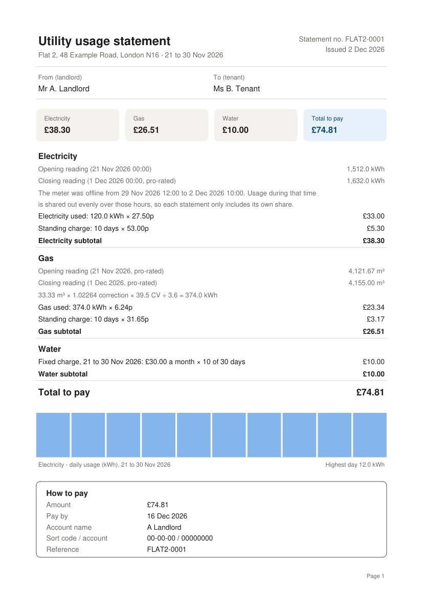

# Energy Statement for Home Assistant

Creates monthly (or weekly/quarterly) utility statements from your meters and
emails them as a PDF to the tenant, with the landlord copied in. Electricity,
gas and water can be combined on one statement. Everything is set up in the
Home Assistant UI; no YAML.

## Install

**HACS (recommended)**
1. Put this folder in a GitHub repository.
2. HACS → ⋮ → Custom repositories → add the repository URL, type *Integration*.
3. Install **Energy Statement**, then restart Home Assistant.

**Manual**
Copy `custom_components/energy_statement` into your Home Assistant
`config/custom_components/` folder (Samba share, File editor or Studio Code
Server add-on) and restart.

Then go to **Settings → Devices and services → Add integration → Energy Statement**.

## Setup screens

1. **Property** – a name (e.g. *Flat 2*), the first supply and where readings come from.
2. **Supply** – meter sensor, unit rate, standing charge on/off, prices effective from.
3. **Schedule and sending** – cycle, start day, **billing starts on** (e.g. the tenancy start date), send time, *Ask me first* or *Send automatically*, and the phone to notify.
4. **People and property** – address, reference prefix, landlord and tenant names and emails.
5. **Payment details** – pay within N days, account name, sort code, account number, optional note.
6. **Email sending** – SMTP details. Fill in *Send a test email to* to check it works.

Change anything later from the integration's **Configure** button. Gas and water
are added there with **Add supply**.

## How amounts are worked out

* **Sensor supplies** (e.g. the Shelly EM1 total energy sensor) use Home
  Assistant's long-term statistics, so offline gaps and counter resets don't
  affect the total. The statement shows the meter reading at the start and end
  of the period and a daily usage chart.
* **If the meter goes offline** (e.g. a WiFi drop), it keeps counting and HA
  receives the total when it reconnects. If an outage spans the end of a
  period, the statement waits until the meter is back, then shares the
  outage's usage evenly over its hours, so each statement includes only its
  own share and nothing is counted twice or missed.
* **Fixed charge supplies** (e.g. water at a flat monthly rate) charge the full
  amount for a whole month and by days for a part month (e.g. 10 of 30 days).
* **Manual supplies** (gas/water without a smart meter) use the readings you
  enter. Usage is **pro-rated** to the period dates by straight line between
  readings, so a reading taken on 3 Nov still gives an exact 1–31 Oct figure.
  The next statement starts from exactly where the last one ended.
* **Gas** in m³ is converted: m³ × correction factor × calorific value ÷ 3.6.
  Imperial meters (hundreds of cubic feet) are converted to m³ first.
* **Water** is clean water per m³ plus wastewater per m³, with a wastewater
  percentage (e.g. 95%).
* **Price changes**: when you change a price, set *Prices effective from*. Days
  before that date keep the old price and the statement splits the lines.
* Prices are entered including VAT. VAT isn't shown; this isn't a VAT invoice.

## Billing start

Set **Billing starts on** to the tenancy start date. The first statement runs
from that day to the end of the period; standing charges are only charged for
those days. For a new tenant later, change the date and send the outgoing
tenant a custom statement.

## When a statement is due

At the send time on the day after the period ends:

* If a manual supply has no reading on or after the period end, the statement
  **waits** and you get a notification asking for it. On the phone you can type
  the reading straight into the notification. It carries on automatically
  once the reading is saved, and reminds you daily until then.
* **Ask me first**: you get a notification with *Approve and send* / *Discard*
  and a link to the PDF. Nothing is sent until you approve.
* **Send automatically**: it's emailed straight away. If sending fails, it
  falls back to waiting for approval and tells you why.

## Entities (on the property's device page)

| Entity | What it does |
| --- | --- |
| *Supply* usage / cost this period | Live figures for sensor supplies |
| Total cost this period | Sum of sensor supplies |
| *Supply* last reading | Manual supplies, with recent readings |
| *Supply* new reading, reading date, save reading, delete last reading | Enter manual readings |
| Statement status | Idle, waiting for readings, awaiting approval |
| Last statement | Amount, reference, period, sent/discarded |
| Next statement | When the next one is due |
| Approve and send / Discard pending | Act on a pending statement |
| Preview this period | Makes a preview PDF of the period so far; never emailed |
| Custom statement start / end + Create custom statement | One-off statement for any dates (move in / move out) |

Custom statements don't change the regular schedule, so take care not to bill
the same days twice.

Actions for automations: `energy_statement.create_statement`,
`preview_statement`, `approve_statement`, `discard_statement`,
`add_meter_reading`.

PDFs are kept in `config/energy_statement/` and are only reachable by logged-in
users or through the signed links in notifications.

## Email tips

* A dedicated mailbox on your own domain works best. Set *Reply-to* to the
  landlord so the tenant's replies go to them.
* Gmail / Google Workspace: `smtp.gmail.com`, port 587, STARTTLS, and an
  **app password** (needs 2-Step Verification).
* Microsoft 365 often blocks basic SMTP login; a different provider is easier.
